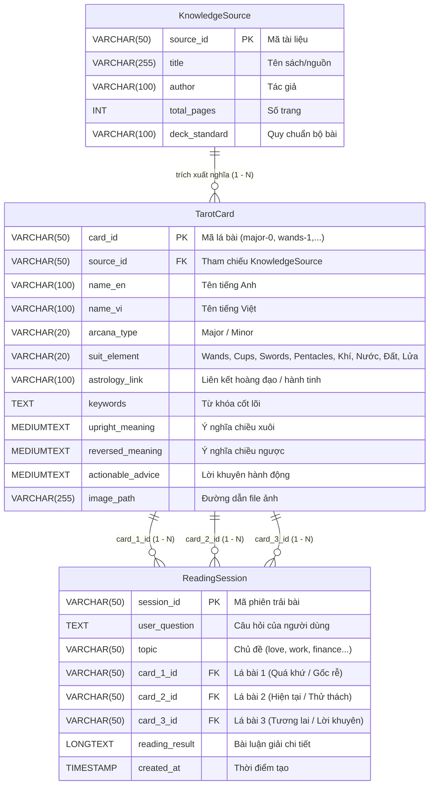

# Hướng Dẫn Cơ Sở Dữ Liệu MySQL - Dự Án Tarot (TarotcuaHalle)

Thư mục này chứa toàn bộ định nghĩa cấu trúc bảng (Schema) và dữ liệu mẫu (Seed Data) chuẩn cú pháp **MySQL (InnoDB / utf8mb4)** phục vụ cho hệ thống trải bài và luận giải Tarot.

---

## 1. Cấu Trúc Thư Mục

```text
04-Database/
├── Database.sql       # Khởi tạo database tarot_db và 3 bảng chuẩn InnoDB utf8mb4
├── Sample_Data.sql    # Dữ liệu nguồn sách & 78 câu lệnh INSERT độc lập cho 78 lá bài
└── README.md          # Tài liệu hướng dẫn cài đặt, thiết kế ERD và truy vấn mẫu
```

---

## 2. Thiết Kế Cơ Sở Dữ Liệu (ERD & Quan Hệ)

Hệ thống được thiết kế tối ưu theo chuẩn quan hệ khóa ngoại (Foreign Keys) với cơ chế toàn vẹn dữ liệu:



---

## 3. Hướng Dẫn Cài Đặt & Nạp Dữ Liệu (Import Data)

### Cách 1: Sử Dụng MySQL Command Line (Khuyên dùng)

Mở terminal tại thư mục gốc của dự án hoặc thư mục `04-Database/`:

```bash
# Bước 1: Khởi tạo database và cấu trúc các bảng
mysql -u root -p < 04-Database/Database.sql

# Bước 2: Nạp toàn bộ dữ liệu mẫu (Sách nguồn, 78 lá bài, phiên trải bài mẫu)
mysql -u root -p --default-character-set=utf8mb4 tarot_db < 04-Database/Sample_Data.sql
```

### Cách 2: Sử Dụng phpMyAdmin / MySQL Workbench / DBeaver / Navicat

1. Mở công cụ quản lý cơ sở dữ liệu và kết nối đến máy chủ MySQL của bạn.
2. Mở file `Database.sql` và nhấn **Execute (Chạy toàn bộ script)** để tạo database `tarot_db` cùng 3 bảng.
3. Mở tiếp file `Sample_Data.sql` và nhấn **Execute** để nạp dữ liệu sách và trọn bộ 78 lá bài.

> **Lưu ý quan trọng**: Đảm bảo máy chủ MySQL và công cụ client sử dụng mã hóa UTF-8 (`utf8mb4`) để hiển thị trọn vẹn dấu tiếng Việt và các ký tự đặc biệt.

---

## 4. Các Câu Truy Vấn Mẫu Hữu Ích (SQL Query Examples)

### 4.1. Lấy danh sách 22 lá Ẩn Chính (Major Arcana)
```sql
SELECT card_id, name_en, name_vi, suit_element, astrology_link 
FROM TarotCard 
WHERE arcana_type = 'Major';
```

### 4.2. Lấy danh sách lá bài thuộc bộ Cốc (Cups / Nguyên tố Nước)
```sql
SELECT card_id, name_en, name_vi, keywords 
FROM TarotCard 
WHERE suit_element = 'Cups';
```

### 4.3. Tìm kiếm lá bài theo từ khóa tâm trạng / hoàn cảnh (Ví dụ: "khởi đầu", "sáng tạo")
```sql
SELECT card_id, name_vi, keywords, upright_meaning 
FROM TarotCard 
WHERE keywords LIKE '%khởi đầu%' OR keywords LIKE '%sáng tạo%';
```

### 4.4. Truy vấn chi tiết một phiên trải bài kèm thông tin của 3 lá bài đã rút
```sql
SELECT 
    r.session_id,
    r.user_question,
    r.topic,
    c1.name_vi AS card_1_name,
    c2.name_vi AS card_2_name,
    c3.name_vi AS card_3_name,
    r.reading_result,
    r.created_at
FROM ReadingSession r
LEFT JOIN TarotCard c1 ON r.card_1_id = c1.card_id
LEFT JOIN TarotCard c2 ON r.card_2_id = c2.card_id
LEFT JOIN TarotCard c3 ON r.card_3_id = c3.card_id
ORDER BY r.created_at DESC;
```
